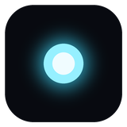
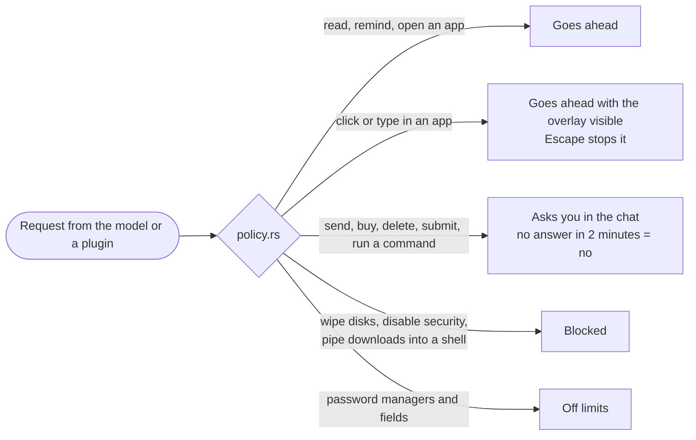

<div align="center">



# Nimbus

**A small island at the top of your screen.**<br>
Your computer's everyday controls one click away, and an AI assistant that does small desktop chores for you, on a model that can run entirely on your own machine.

[](../../releases/latest)


[](LICENSE)

<a href="docs/media/nimbus-1.0-promo.mp4">
  
</a>

<sub>Real screen recording, sped up. <a href="docs/media/nimbus-1.0-promo.mp4">Watch the full-quality video (MP4)</a>.</sub>

[**Download**](../../releases/latest) · [What it does](#what-it-does) · [Safety model](#safety-model) · [Privacy](#privacy) · [How it is built](#how-it-is-built)

</div>

---

Nimbus 1.0 is the rewrite of my first [Nimbus](https://github.com/HarshaVardhan3002/nimbus), an Electron overlay. The first version could only look and answer. This one can also act: it clicks and types in apps, follows routines and listens for "Hey Nimbus". Everything risky asks you first.

## What it does

Collapsed, the island shows what matters right now: the music playing and the time. Hover it to peek, open it (click, or Ctrl+Alt+Space) for eight pages.

<table>
<tr>
<td width="50%" valign="top">

**🎛️ Controls**<br>Media, volume, brightness, Wi-Fi, Bluetooth, dark mode

**📅 Today**<br>To-dos, reminders, alarms, a timer and routines

**📊 Stats**<br>CPU, memory, graphics, disk, network, battery and the busiest apps

**📋 Clipboard**<br>Clipboard history you can search, pin and paste again

</td>
<td width="50%" valign="top">

**🔎 Apps**<br>App launcher and instant search over file names

**🖼️ Wallpaper**<br>Wallpapers, Wallpaper Engine included

**⏻ Power**<br>Battery, lock, sleep, restart, shut down

**💬 Chat**<br>The assistant, typed or spoken

</td>
</tr>
</table>

The island works fully without AI. The assistant is there when you want it.

### The assistant

| | |
|---|---|
| **Your model, your choice** | **Local:** Nimbus picks a llama.cpp build for your graphics chip (CUDA for NVIDIA, Vulkan for AMD and Intel, Metal on Apple silicon) and the best model that fits your memory, and downloads both. The model loads on your first message and unloads after 30 idle minutes, so the memory comes back. **Cloud:** any OpenAI-compatible API. |
| **Tools** | Web search, reading pages, Spotify and YouTube, reading mail for a briefing, reminders, opening apps and pages |
| **Hands** (opt-in) | Clicking and typing in other apps through Windows UI Automation. It works by control name, not by pixel guessing, so it also works with models that cannot see. Escape stops it at any moment. |
| **Eyes** (opt-in) | While it works on a request, it can look at the screen |
| **Voice** | "Hey Nimbus" and push to talk, transcribed by a local Whisper model. It can also listen to what your computer plays (a video, a call) and answer questions about the last 20 seconds. |
| **Routines** | Saved step-by-step instructions it carries out on its own, by hand or at set times ("at 8, brief me on my mail") |
| **Plugins** | Any Model Context Protocol (MCP) tool server works as a plugin. A local API lets plugins pass Nimbus a request or show a notice in the island. |

## Safety model

The rules live in one file, [`agent/policy.rs`](app/src-tauri/src/agent/policy.rs), and nothing a model or plugin says can change them.



Mail is **read-only by construction**. The IMAP client can send exactly six commands (sign in, open read-only, search, fetch without marking read, sign out). There is no SMTP code at all. Writing a reply goes through a draft that you send yourself.

## Privacy

- 🔒 Clipboard history, the file index and conversations stay on your computer. Sign-ins live in the system credential store (Windows Credential Manager, macOS Keychain, Secret Service), never in Nimbus's own files.
- 🖥️ Screen frames are small JPEGs held in memory only while a request runs, never written to disk.
- 🎧 Sound is transcribed and dropped. Only the words are kept, and only for the last 20 seconds.
- 🫥 "Hide from screen capture" keeps the island out of screenshots, recordings and screen shares. Nimbus reads the setting back from the operating system and only reports itself hidden when the OS confirms it.
- 📡 Nothing is sent anywhere except to the model and the services you set up yourself.

## How it is built

```
app/src/                Svelte 5 front end: the island, its pages, the chat
app/src-tauri/src/      Rust back end (Tauri 2)
  agent/                The agent loop, tools, policy, screen, hands, web, play
  brain.rs, models.rs   Local model: picking, downloading, loading, unloading
  runtime.rs            Which llama.cpp build fits this machine
  voice.rs, speech.rs   "Hey Nimbus", push to talk, speech to text
  hearing.rs            Listening to system audio (loopback only)
  plugins.rs, api.rs    MCP plugins over stdio and the local plugin API
  mail.rs, oauth.rs     Read-only IMAP, Google and Microsoft sign-in
  routines.rs           To-dos, reminders, alarms, routines and their scheduler
  island.rs, privacy.rs The click-through island window, capture exclusion
crates/system/          System controls: media, volume, brightness, radios,
                        power, wallpapers (incl. Wallpaper Engine), stats, apps
```

About 25,000 lines of Rust, Svelte and TypeScript. The island window is larger than the visible island, so it can grow and shrink with CSS animation instead of window resizes (which flicker). Everything outside the island's current shape lets clicks through.

## Download

Get the installer for your system from [Releases](../../releases/latest):

| System | Files |
|---|---|
| Windows | `.msi` or `-setup.exe` |
| macOS | `.dmg` (Apple silicon and Intel) |
| Linux | `.AppImage`, `.deb` or `.rpm` |

The installers are not code-signed yet. On Windows, SmartScreen may warn: choose "More info", then "Run anyway". On macOS, right-click the app the first time and choose Open.

Nimbus is built and used every day on Windows. The macOS and Linux builds are newer and less tested, and some system controls are Windows-only for now.

## Build it yourself

You need Rust 1.85 or newer, Node.js 22, and on Linux the [Tauri system libraries](https://v2.tauri.app/start/prerequisites/).

```sh
cd app
npm ci
npm run tauri dev      # run it
npm run tauri build    # make an installer
```

## License

[MIT](LICENSE)
